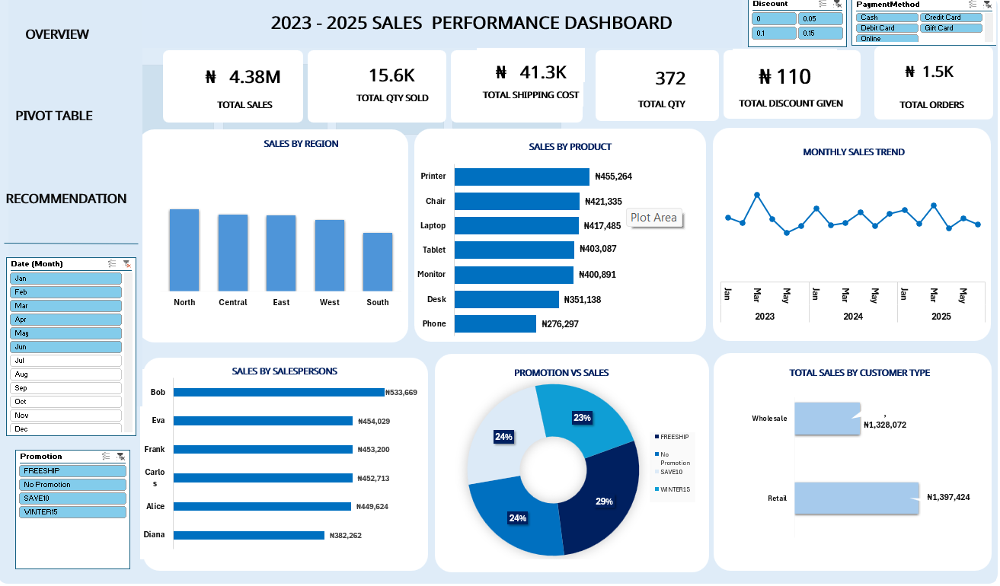

Sales Performance Analysis (2023–2025)

Project Overview

This project analyses sales performance data to identify trends, evaluate product and regional performance, understand customer purchasing patterns, and assess the impact of promotions.

The goal is to transform raw sales data into meaningful insights that support business decision-making.

Tools Used

* Microsoft Excel
* Pivot Tables
* Excel Charts and Data Visualization
* Slicers and Interactive Dashboard
* Data Analysis and Business Reporting

Project Objectives

* Analyse sales performance over time.
* Compare sales across regions and product categories.
* Evaluate customer purchasing behaviour.
* Examine promotional performance.
* Present key performance indicators in an interactive dashboard.

Dashboard Preview

Key Areas of Analysis

* Sales Trends: Understand how sales change over time.
* Regional Performance: Compare sales across geographical regions.
* Product Performance: Identify products and categories contributing to sales.
* Customer Analysis: Explore purchasing patterns across customer segments.
* Promotional Analysis: Assess sales performance associated with promotions.

Business Value

This project demonstrates how Excel can be used to organise data, analyse business performance, and communicate findings through an interactive dashboard.

The analysis can help stakeholders identify performance gaps, investigate sales trends, and make more informed decisions about products, regions, customers, and promotions.

Skills Demonstrated

Microsoft Excel | Data Cleaning | Data Analysis | Pivot Tables | Dashboard Development | Data Visualization | Business Intelligence

Author

Nwigbo Chinaecherem Emmanuella

Data Analyst | Excel | Power BI | SQL

I am building my data analytics portfolio through practical projects focused on turning data into actionable business insights.
